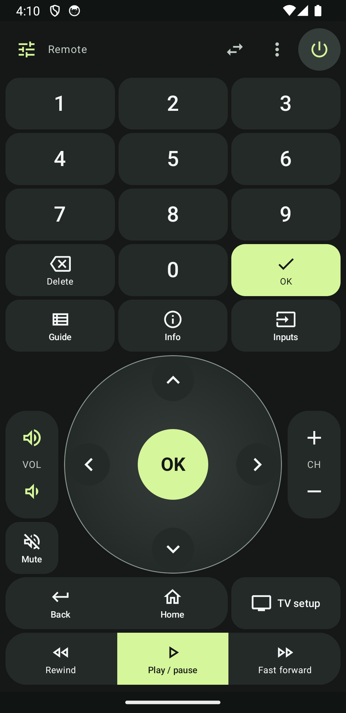
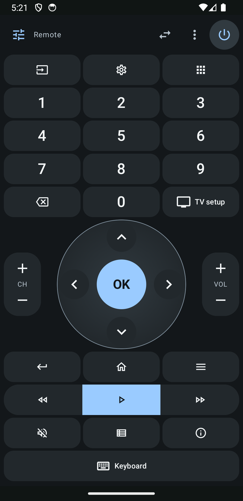
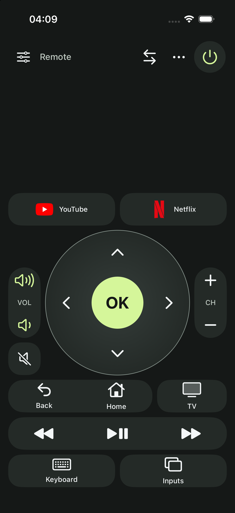

# OpenTV-Remote

**Free and open source, under the [MIT License](LICENSE).** Anyone can use, modify and share it. No subscription, ads or account required.

[Download & installation guide](https://levhakobyan.github.io/OpenTV-Remote/) · [Development releases](https://github.com/levhakobyan/OpenTV-Remote/releases)

A phone remote with automatic network discovery, saved TVs and capability-aware controls. Android uses Kotlin / Jetpack Compose (Android 9+, debug target API 34). The iPhone app uses native SwiftUI (iOS 17+) with the same remote, editable grid, eight visual templates, independent hand preference, accent colors and shortcuts. See [iPhone setup](ios/README.md) and [iOS compatibility research](docs/IOS_RESEARCH.md) for platform differences and verification.

## Screenshots

| Android remote | Your own colors | iPhone remote |
| --- | --- | --- |
| [](downloads/assets/android-remote.png) | [](downloads/assets/sky-remote.png) | [](downloads/assets/iphone-remote.png) |

Actual development-app captures with example layouts and local protocol fixtures. Tap an image for full size. TV capabilities determine the available controls.

## Current scope

Both apps support English and Russian using native localization. Open the remote menu → Language, the globe button on Devices, or Language in About to choose System, English or Русский. The selection updates immediately and survives restart; saved TV/app/preset names and typed text are never translated. Casting UI, SDKs and file-sharing servers are removed.

The same eight preset geometries, capabilities, app slots and hand variants are locked by **336 actual Kotlin/Swift runtime comparisons** under `shared/`. iOS previews now use the same miniature drawing, proportional cells and descriptions as Android. Live numeric controls remain real digit keys.

The TV Companion app and its phone-side transports have been removed. Current pointer support depends on an implemented native TV provider or Android Bluetooth HID; there is no separately installed TV receiver or Internet relay.

The display name is now **OpenTV-Remote**. Existing `com.luma.remote` / `com.luma.remote.ios` application IDs and credential namespaces are intentionally retained so installed-app updates preserve pairing and layouts. Project, scheme, module and source-file names use OpenTVRemote. Older verification records/screenshots may show the former Luma Remote branding.

## Project structure

```text
android/    Complete Android Studio / Gradle project, including app/ and its tests
ios/        Native SwiftUI iPhone app, Xcode project, Swift core and native UI tests
shared/     Cross-platform preset contract and normalized fixtures
docs/       Shared research, architecture, UI references and verification records
scripts/    Project utilities, including the APK sharing script
tools/      Local TV protocol receivers for development testing
```

Open `android/` in Android Studio or `ios/OpenTVRemote.xcodeproj` in Xcode. The [iPhone parity checklist](docs/IOS_PARITY.md) records shared behavior and remaining hardware qualification. Platform credentials and build products remain separate. The outer workspace folder stays in its current location.

**This is a development build, not a claim of universal TV compatibility.** Android includes real Android TV Remote v2, Samsung Tizen WebSocket, legacy LG SSAP, Bluetooth HID. Casting has been removed from both phone apps. iPhone has separate provider and platform limits described below. Fire TV Wi-Fi, Roku ECP, screen mirroring and secure-only LG port 3001 are not offered. See the [Android compatibility matrix](docs/RESEARCH.md), [iOS matrix](docs/IOS_RESEARCH.md) and [verification record](docs/TESTING.md).

## Build

Use JDK 17 (the command below uses this Mac’s installed Homebrew JDK; adjust it on another machine) and Android SDK Platform 34 / build tools 34.0.0. Android Studio can import `android/` directly. Set `ANDROID_HOME` or create an untracked `android/local.properties` with your SDK path.

```sh
export JAVA_HOME=/opt/homebrew/opt/openjdk@17/libexec/openjdk.jdk/Contents/Home
export ANDROID_HOME="$HOME/Library/Android/sdk"
./android/gradlew -p android assembleDebug testDebugUnitTest lintDebug
```

Run the command from the workspace root. From inside `android/`, use `./gradlew assembleDebug testDebugUnitTest lintDebug`. Output: `android/app/build/outputs/apk/debug/app-debug.apk`. The wrapper pins Gradle 8.9; AGP 8.7.3 / Kotlin 2.0.21 are fixed in `android/build.gradle.kts`. Dependencies download from Google/Maven Central. No API keys or backend credentials are needed for the included providers. A current Play Store release needs target-SDK/dependency upgrades, policy review and hardware qualification.

## GitHub Pages downloads

The checked-in [Pages workflow](.github/workflows/pages.yml) publishes an English static download page from verified GitHub Release assets. It keeps APKs and signing keys out of Git, preserves the APK's existing signature, and shows an honest pending page before the first release. The public [download site](https://levhakobyan.github.io/OpenTV-Remote/) includes Android releases, remote screenshots and iPhone installation steps. See [Pages and release maintenance](downloads/README.md) for updates.

## Download the APK on a phone

The sharing script is provided for **you to run**. It has not been used to open a Cloudflare tunnel during development.

```sh
./scripts/share-apk.sh
```

Requires Python 3 and `cloudflared` (`brew install cloudflared`). It requires the Android phone debug APK and copies only that APK, its checksum file and the download page into a fresh temporary directory, starts a server bound to loopback, verifies its identity, then asks Cloudflare for a temporary `https://…trycloudflare.com` URL. Open that URL on your Android phone and choose Download Android APK. Keep the terminal open; Ctrl-C closes the tunnel, stops the server and removes the temporary share files. The project directory, secrets and source files are never the web root. Override the port with `PORT=8790 ./scripts/share-apk.sh` if needed. Cloudflare Quick Tunnels are temporary and depend on network availability.

To prepare the standalone HTML and phone APK **without starting a server or tunnel**:

```sh
python3 tools/prepare_downloads.py
```

Open `build/downloads/index.html` locally to preview. The tracked template is `downloads/index.html`; the sharing script uses this same page. All download URLs are relative, so the prepared directory can later be used under a GitHub Pages project path. Generated APKs stay in ignored `build/`; no publishing is performed. See [download page notes](downloads/README.md).

Allow installation from your browser only when you choose to install the debug APK. No phone installation is needed to review the screenshots in `docs/screenshots`.

## iPhone

Open `ios/OpenTVRemote.xcodeproj`, choose **OpenTVRemote** and an iPhone Simulator, then Run. For a physical iPhone, select your own signing team and Run on the connected phone. No signing team was selected or created during implementation; no signed IPA/TestFlight release is supplied. The Android APK cannot install on iOS.

```sh
swift test --package-path ios
xcodebuild -project ios/OpenTVRemote.xcodeproj -scheme OpenTVRemote \
  -sdk iphonesimulator -destination 'generic/platform=iOS Simulator' build
```

Android TV and Samsung have native protocol-fixture acceptance evidence. LG TV-app interoperability still require hardware qualification. iOS Bluetooth HID parity is unavailable. Physical-iPhone Samsung/LG SSDP needs Apple's restricted multicast entitlement; declared Android TV Bonjour and manual IP remain available. See [setup and fixture tests](ios/README.md).

Native iPhone captures: [remote](docs/screenshots/current/ios/remote-classic.png), [presets](docs/screenshots/current/ios/presets.png), [editor](docs/screenshots/current/ios/editor.png), [appearance](docs/screenshots/current/ios/appearance.png).

## Visual picker and drag resizing

Add controls shows pictures of the actual control shapes: joined volume/channel rails, navigation/playback groups, D-pad, touchpad and keypad. Buttons use the same icons as the live remote, and app cards use their saved/catalog badges. Small captions and full accessibility labels identify each card. Previews are read-only; choosing a card edits the draft. The picker remembers its category between additions and supports search.

Select any item and tap **Resize** to show its drag corner, including 1×1 buttons and narrow rails. Drag to change dimensions; tap **Move** to return to rearranging. The size-value button opens exact width/height controls. Larger widgets retain their direct corner shortcut. While dragging, a solid green target/check shows where the control will land; a dashed red target/cross marks an invalid drop. Resize/move interactions do not send TV commands, and the automatic-height and Undo behavior remain.

Layout customization now has a single grid editor. The duplicated block-settings screen and Use preset remote escape are retired; choose a built-in or saved custom preset within the same editor. Existing saved legacy layouts still render, and TV-button mapping remains available from Remote menu → TV button. Fitting is always automatic, including previous fit=false records; there is no Fit toggle. TV name is removed from the picker; existing manually placed items still open TV selection. Existing manually placed TV-name items remain. The toolbar uses Remote/Touchpad instead of the implementation label Custom. An empty remote has a real Add controls action that opens the visual picker.

## Automatic layout

The canvas grows when a new control needs space or when an item is dragged/resized below the current layout. Dragging near the lower edge scrolls and opens temporary drop space. Only occupied height is retained after drop; moving/removing the last item trims unused trailing rows. The Add row button is removed. Existing control positions and intentional gaps remain; old saved row counts are trimmed on load without discarding controls. Blank layouts show an add-control empty state. Grid and item limits remain 24 rows and 48 controls. Sparse remotes keep comfortable control heights rather than stretching a single button over the whole display.

## Joined controls and touchpad

Volume uses accent-colored speaker icons for louder/quieter; channels keep neutral +/− icons and CH labels. The distinction is shared by the live remote, All controls, widget picker and preset previews. Volume and channel rockers, Back & Home, and playback are joined widgets: move or resize the complete group while keeping its shape. Add controls opens Widgets first; individual commands remain in Buttons. Existing arrangements are preserved. In Edit, select one of the touching matching buttons: **Join** appears in the selected-item bar and affects only that group. **Split** appears in the same place for joined groups. Join is no longer in Presets. New presets use the joined controls by default.

The editor has no visible movement-arrow row. Drag directly, or select an item then tap an empty grid cell; screen-reader move actions remain available. Size and remove are in the compact selected-item bar. Resize mode makes drag handles available for narrow rails while keeping normal dragging for movement.

The touchpad shows the finger position and direction feedback. Swipe to navigate, tap anywhere to select, and continue swiping to traverse lists. The first 18dp step responds earlier; subsequent 32dp steps are bounded to one key per 90ms. Releasing/cancelling ends that contact without a timer or replay queue. This remains directional navigation on Android TV Wi-Fi and relative pointer movement on LG / Bluetooth mouse connections.

See [architecture](docs/ARCHITECTURE.md) for the feature folders and future TV/iOS boundaries.

## Layout and motion

Tap Tune to edit individual controls on a grid. Drag a button/widget directly anywhere with room, resize using the size dialog (larger controls also have a corner handle), remove it, or add any supported command (Menu, Inputs, digits and playback included). The All controls panel follows a physical remote: power/source controls, a numbers-only keypad, D-pad between symmetric volume/channel rails, Back/Home/Menu, playback and secondary keys. Hold behavior uses the same command path as the main remote. The picker also offers D-pad, touchpad, keypad, keyboard and app widgets. Equal-sized controls can swap; overlap/out-of-bounds moves are rejected. Undo and screen-reader movement actions are provided. Done commits per-TV changes; Cancel preserves the current remote. App catalog choices in a draft are committed only with Done. Previous pairing, TV mappings and saved layouts remain stored.

Deleting a control automatically removes wholly empty rows. For existing gaps or rows left after moving controls, **Remove empty rows** appears beside Add controls only when needed. Both operations support Undo. Dragging itself preserves the highlighted destination and other controls; existing saved layouts are not compacted internally merely by opening them.

Resizing automatically pushes colliding controls downward, including cascades. Groups keep their shape and unrelated controls stay in place. The live preview shows the displaced controls at their proposed positions; release commits one undoable edit. The exact-size dialog uses the same operation. Growth into a control starting above the selection or beyond the 24-row limit is rejected without partial changes. Ordinary movement/swap rules are unchanged; shrinking leaves lower controls in place, with Remove empty rows available for remaining gaps.

The canvas keeps targets at least 48dp and automatically uses available row height; larger canvases/narrow windows scroll. Normal long presses continue repeating commands, so editing is entered explicitly through Tune. While editing, all preview controls are inactive and cannot accidentally send TV commands. Power and recovery/navigation menus stay reachable outside the canvas.

**Motion remote** in the overflow menu uses the phone gyroscope only while held. Pointer mode requires an actual pointer-capable TV connection (LG SSAP or Bluetooth HID mouse mode). Android TV offers the explicit Arrows alternative: phone movement sends navigation keys, not a mouse cursor. Gravity/accelerometer posture projection supports flat or upright use; sampling is 50 Hz. No camera, microphone or high-rate sensor permission is used. Motion stops on release, closing the panel, app pause, switching TVs or connection/capability loss. Relative pointing and sensitivity still require physical-phone/TV testing; Android TV Wi-Fi remains a key-only transport. A separate Bluetooth HID mouse connection can provide real pointing if both devices and the TV app accept it.

## Appearance

Open Remote menu → Appearance (also available from the Devices/onboarding header). Choose Lime, Sky, Lavender, Rose, Amber or Aqua, or Custom color to open a visual saturation/brightness field and rainbow hue slider. Six-digit RGB hex and accessible fine controls remain available. Choose color returns to the appearance preview; Use color applies it. The dialog previews coordinated surfaces, controls and the in-app mark. Cancel preserves the current color; Use color saves it for the app. Custom tones are adjusted for readable contrast on the dark surfaces. App/service logos, error colors and the Android launcher icon retain their own colors.

Appearance is stored independently from TV layouts, named presets and hand preference. Applying, saving, deleting or undoing a preset never changes the accent. Left/Right hand is independent too: choose it in the preset gallery before applying a built-in layout. It also controls the rocker sides in All controls. Your saved custom layouts retain their exact positions.

## Daily remote controls

Android TV keyboard editing uses a transient live session when field readback and confirmations are available, with explicit manual Send otherwise. Auto keyboard remains optional. See [keyboard synchronization](docs/KEYBOARD_SYNC.md) and [protocol evidence](docs/IME_PROTOCOL_RESEARCH.md) for Unicode, selection, lifecycle, privacy and hardware limits.

Eight templates—Classic, Live TV, Streaming, Touchpad, Minimal, Big buttons, Full remote and Numbers & touch—are available as visual previews through Customize remote → Presets. Minimal now contains navigation, volume/mute and Back/Home; Live TV prioritizes numbers/channels/Guide; Streaming keeps apps and playback; Full remote follows All controls. Left/Right hand is a separate saved preference above the previews: it swaps volume/channel sides in built-in templates and the All controls sheet, while numbered keys and saved custom layouts keep their positions. Save the draft with a unique name using Save current (up to 12). Saved presets include app targets and can be applied to any saved TV; unsupported controls are explained and omitted. Apply changes the draft and remains undoable; Done commits the remote. Saving/deleting a named preset is an explicit independent action. Delete requires confirmation. Power, TV switching and recovery remain outside the editable canvas. The bottom navigation is hidden throughout a selected TV remote session, including reconnects. Number-pad, keyboard, navigation and app widgets can be placed individually; the TV action can map to an input/channel key or a saved app where supported. Older block layouts are retained only for stored-data compatibility, not exposed through a second settings editor.

Touch uses swipes to send ordinary D-pad commands and tap for OK on devices with full navigation; it is not a mouse cursor. LG pointer-capable devices and Bluetooth HID mouse connections use relative pointer movement; Bluetooth adds tap-to-click and two-finger wheel scrolling. D-pad directions, volume, channels, Delete and rewind/fast-forward support holding; Android TV arrows and OK preserve native DOWN/UP duration. Other connections send one OK rather than repeated selections. Release/cancel/background/device-switch/connection loss and opening a panel stop active holds. Home/Back/Power and play/pause stay single-action. See [press and hold behavior](docs/REMOTE_ACTIONS.md) for protocol limits and the optional joystick design. Seek repeats use a slower 250ms interval after a 400ms initial delay; the TV player decides how those keys affect catch-up or live playback.

Android TV adds a 0–9 panel, channel keys, Inputs, Guide, Menu, Info, Settings and All apps where key injection is available. TV-specific keys may be ignored. **TV setup** lets you test and choose Live TV, Inputs, Channel +, a saved app link, or hide the TV button. The TV does not report whether its channels actually opened; there is no automatic success claim or forced sequence of fallback commands.

The Apps panel offers a ready-made catalog: YouTube, Netflix, Prime Video, Spotify, Disney+, Twitch and Plex, with no URL entry required. Add/remove up to eight shortcuts per TV, and place favorites anywhere using Add controls → Apps. Custom app or link in Add controls → Apps accepts custom HTTPS links and add publisher deep links or Android TV package IDs, with selectable icons and an in-app setup guide. App IDs use the experimental `market://launch?id=…` route; a compatible TV/Play Store handler is required. Raw intents and script/file/content links are rejected. These are official web entry points sent via Android TV APP_LINK, not installed-app discovery or guaranteed native-app launch. The receiving TV must handle the link; a browser may open instead. No paid service account or subscription is provided. YouTube/Netflix use bundled marks; other catalog entries use category icons.

Pairing data, last TV, layouts, TV action and shortcuts survive updates/restarts. Layouts and shortcuts are stored separately per TV and removed when that TV is forgotten. Existing 0.2 data receives the Classic default without changing pairing credentials.

## Connect

1. Put phone and TV on the same home LAN; turn the TV on. Select **Find my TV**. No brand/model input is required.
2. Android TV / Google TV: choose the discovered TV and enter its six hex characters. Android TV Remote Service must be installed/enabled. Its negotiated features determine the controls. First pairing uses the on-screen code to authenticate the certificate; later connections pin it.
3. LG webOS: choose a detected TV, acknowledge the plaintext legacy transport, then accept the prompt on the TV. This release supports port 3000 only. Firmware requiring 3001 needs a future secure provider.
4. Saved TVs appear in Devices. Tap one to switch. Forget removes its pairing pin/key; use this after a factory reset or changed identity. Discovery refreshes saved addresses when a stable device ID is found again.
5. If discovery fails, use **Connect by IP**. Only local IPv4 literals are accepted; service ports are probed to select Android TV or LG. IPv6-only and unusual LAN addressing are not supported yet.

No remote actions are replayed. Returning from the background reconnects the selected TV; a dropped established Wi-Fi session gets one automatic reconnect attempt. Further failure shows an explicit Reconnect action. Switching networks never automatically sends power or navigation commands.

## Samsung Tizen local Wi-Fi

Compatible Samsung TVs are classified from SSDP descriptions and bounded `/api/v2/` metadata. Normal setup does not ask for brand/model. If multicast discovery fails, Connect by IP checks the actual device metadata/services. Modern local Tizen WebSocket TVs (commonly 2016 onward) are the target; pre-Tizen TCP/encrypted legacy protocols are not implemented. Compatibility still depends on TV firmware.

1. Keep phone and TV on the same trusted LAN and turn the TV on. Select the discovered Samsung TV.
2. For the first secure connection, confirm the TV's local certificate in OpenTV-Remote. Unknown certificates stop TLS before a token or HTTP request is sent. This is explicit trust on first use on your home network, not public-CA authentication or a vendor-signed identity check.
3. Allow **OpenTV-Remote** on the TV. If no request appears, inspect Device Connection Manager / Device List / access notification settings; names differ by firmware. No code or Samsung account is required by this local provider.
4. TV approval/token and certificate pin are encrypted in Android Keystore-backed storage. Relaunch and network recovery reuse them. An expired token is discarded and requests TV approval once; a denied request does not cause repeated automatic prompts. Commands are not replayed.
5. If the certificate changes, OpenTV-Remote blocks the connection. Use **Reset Samsung pairing** only when you expect a TV update/reset and trust the network. This resets Samsung credentials while retaining layout and saved shortcuts; confirm the new identity and TV approval again.
6. A verified Samsung metadata service on port 8001 can offer **Try legacy Wi-Fi** after secure connection failure. It needs separate consent: commands and typed text are unencrypted. Secure tokens are never sent/stored from a plaintext socket. A visible legacy indicator and **Try secure Wi-Fi** let you return to secure mode without deleting the layout. There is no automatic security downgrade.

Implemented key transport covers navigation/OK/Back/Home, volume/mute, channels/digits, Guide/Info/Menu, Inputs/TV, seek and power toggle **while connected**. A successful channel does not prove every TV app handles each key. Metadata gates directional navigation and manual text input; there is no automatic TV-focus keyboard event for Samsung. Power-on/wake from an unreachable TV, true Wi-Fi mouse/gyro pointer, generic app shortcuts/installed-app launching, Settings/Delete/App drawer and a reliable combined Play/Pause toggle are not advertised by this provider.

This provider is implemented independently from protocol facts in [Samsung TV WS source](https://github.com/xchwarze/samsung-tv-ws-api) and [Home Assistant's Samsung documentation](https://www.home-assistant.io/integrations/samsungtv). The LGPL upstream Python library is not bundled or translated into the app. No SmartThings service integration, developer credentials or cloud relay are required. Real Samsung TV qualification is still pending; see the verification record.

## Keyboard

The keyboard tile opens the native phone keyboard. Android TV field-show messages can open it automatically when Auto keyboard is enabled. Usable readback and confirmations enable live range edits and TV text/selection updates; unsupported, private or ambiguous fields use explicit Manual Send. Enter is a separate TV key. Neither editor content nor passwords are saved. See [keyboard behavior and limits](docs/KEYBOARD_SYNC.md); real YouTube Search/TV Bro qualification of live sync remains pending.

## Bluetooth

Bluetooth is opt-in under Devices → Bluetooth remote. Nearby devices permissions are requested only here (Android 12+ CONNECT and ADVERTISE); no Bluetooth scan/location request is needed. HID registration starts before pairing so the phone advertises a mouse/keyboard accessory. Enable Bluetooth, make the phone discoverable, pair from TV accessory settings, then refresh/select the TV. The setup panel reports profile/registration errors and offers Retry. If the TV rejects the combo device, turn off Mouse + keyboard for keyboard-only mode and re-pair if needed. A phone/TV may cache the old HID descriptor: forget the pairing on both sides before changing modes if reconnect fails.

Mouse mode sends report ID 2 with relative X/Y, left-button press/release and wheel ticks. Use a Touch preset or Touchpad widget; move one finger to point, tap to click, or scroll with two fingers. Motion remote → Pointer uses the same real mouse transport while held; a gyroscope is required. Arrows mode remains available. Keyboard report ID 1 retains arrows/Enter/Escape/Home; Home/Back mapping varies. No Bluetooth power, volume, app launching, casting or universal text support is claimed. Keep OpenTV-Remote foregrounded; HID registration may end in the background. Reconnect from the remote if the TV disconnects. Bluetooth does not require shared Wi-Fi and this release selects one TV transport at a time; switch back to the saved Wi-Fi TV for its full TV-specific controls. Profile registration/connection does not prove that every TV app accepts a pointer. No physical HID hardware qualification has been performed. See [Android HID API](https://developer.android.com/reference/android/bluetooth/BluetoothHidDevice) and [permission requirements](https://developer.android.com/develop/connectivity/bluetooth/bt-permissions).


## Code map

Paths below are relative to `android/app/src/main/java/com/luma/remote/`.

- `protocol/Models.kt`: explicit state/capability and provider contracts.
- `protocol/Discovery.kt`: mDNS + bounded SSDP descriptions and local-address validation.
- `protocol/AndroidTvProvider.kt`, `Wire.kt`: pairing, pinned TLS, bounded protobuf framing and negotiated control.
- `protocol/WebOsProvider.kt`: paired SSAP, command responses and pointer channel.
- `protocol/SamsungProvider.kt`: pinned local WebSocket approval, token lifecycle, bounded messages and explicit legacy mode.
- `protocol/BluetoothProvider.kt`: system HID registration and press/release reports.
- `data/Vault.kt`: AES-GCM encrypted TLS identity/pairing secrets protected by Android Keystore; backups/transfers disabled.
- `RemoteViewModel.kt`: selected device, command serialization, foreground/network transitions and saved TVs.
- `ui/OpenTVApp.kt`, `ui/remote/RemoteScreen.kt`: compact Compose onboarding, remote/keypad/shortcuts, pairing, discovery and connection recovery.

No account, telemetry SDK, microphone access, TV Accessibility service or ADB-based TV control is included. See [research and dependency notes](docs/RESEARCH.md).

## Interface review


Current UI audit: [interface audit](docs/UI_AUDIT.md). Shortcut asset credits: [third-party icons](docs/THIRD_PARTY_ASSETS.md).

Current interface: [all controls](docs/screenshots/current/rockers-all-controls.png), [presets](docs/screenshots/current/presets-preview.png), [colors](docs/screenshots/current/appearance-options.png), [color picker](docs/screenshots/current/color-picker.png), [distinct volume/channel controls](docs/screenshots/current/rockers-distinct.png), [custom app](docs/screenshots/current/custom-app.png), [remote](docs/screenshots/current/remote.png), [visual picker](docs/screenshots/current/picker-widgets.png), [button picker](docs/screenshots/current/picker-buttons.png), [app picker](docs/screenshots/current/picker-apps.png), [resize](docs/screenshots/current/resize-channel.png), [allowed drop](docs/screenshots/current/drop-allowed.png), [blocked drop](docs/screenshots/current/drop-blocked.png). Connected captures use the local protocol fixture. Restart a running share-apk.sh process to serve the new APK; a running share keeps its initial copied APK.

## License and attribution

Original project code is available under the [MIT License](LICENSE). Third-party libraries, the Gradle wrapper and bundled service icons retain their own licenses and trademarks; see [asset credits](docs/THIRD_PARTY_ASSETS.md) and the dependency notes in [research](docs/RESEARCH.md). OpenTV-Remote is an independent project and is not affiliated with TV manufacturers or NAGRA's OpenTV platform.
